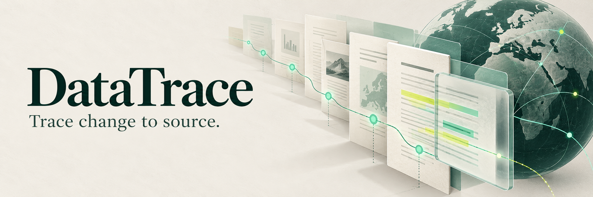

<p>
  
  
</p>

<br clear="all" />

[简体中文](../../README.md) · [繁體中文](README.zh-TW.md) · **English**

# DataTrace

**Trace every regulatory change back to its source.**

DataTrace is a regulatory tracking workspace for cross-border product, privacy and compliance teams, focused on data protection, finance and telecommunications in Hong Kong and Singapore. It connects official instruments, provision summaries, change events and source health in one reading flow—from what changed to the evidence behind it and what to check next. The public site is an accessible static demo; the repository also contains the full server application.

## Who it is for

- Privacy and compliance teams researching rules by jurisdiction and topic, with links back to official text.
- Cross-border product and business teams preparing evidence for internal discussions about relevant changes.
- Developers and researchers exploring the path from source collection and storage to static publication.

## 8 feature modules

### 01 · Regulatory radar and overview
**Available in the demo**

See counts of regulations, structured obligations and historical events alongside recent updates. Start with coverage and new signals, then move into the library or timeline.

**What you get：** An overview you can explore further to decide which change to investigate first.

### 02 · Multidimensional regulation library
**Available in the demo**

Combine jurisdiction, industry, topic, instrument type and keyword filters. Filter selections are reflected in the URL, making a result set easy to revisit or share.

**What you get：** A focused reading list for a specific research question.

### 03 · Structured provisions and official text
**Available in the demo**

Details show the issuing authority, effective and version dates, source-check date, and available provision summaries and keywords. Every regulation links to its official source; records awaiting provision breakdown are labelled.

**What you get：** Understand the structure and main points before checking the original instrument.

### 04 · Regulatory change timeline
**Available in the demo**

Browse commencement, amendment and guidance events over time, filtered by jurisdiction. Events display their jurisdiction, industry tags and official source. Published history is retained; the current list displays at most 100 entries per request.

**What you get：** Follow the evolution of a rule rather than reading isolated headlines.

### 05 · Source health and coverage signals
**Available in the demo**

Distinguish successful collection, unavailable sources, no parsing matches and sources not yet checked. Available last-success information is shown, and historical data remains readable during source failures.

**What you get：** Understand why there are no new entries and whether a manual check is needed.

### 06 · Collection, review and static publishing
**Implemented / demo automation**

The server collects official sources, detects duplicates and stores pending-review records. CLI tools support approval, rejection and editing. A daily workflow collects Hong Kong and Singapore sources and publishes an automatically admitted demo snapshot.

**What you get：** Maintainers can trace how content arrived and was published; automated admission is distinguished from human review.

### 07 · Three-language reading and sharing
**Available in the demo**

Repository homepages and the product interface support Simplified Chinese, Traditional Chinese and English, with language preferences retained. Direct links open regulation details, and the mobile layout supports browsing and filtering.

**What you get：** Collaborate across interface languages while keeping official source documents in their original language.

### 08 · Subscriptions and email briefings
**Server implemented / email inactive**

The server includes jurisdiction preferences, double opt-in, subscription management, unsubscribe links, dispatch queues and delivery receipts. The public static site only demonstrates this experience; live subscription writes, daily email and alerts are not enabled.

**What you get：** A path to a hosted service, subject to a backend, mail configuration and separate delivery-channel validation.

## How to use it

1. Start with the radar to understand coverage and recent changes.
2. Narrow the library by the jurisdiction, industry or topic you need.
3. Open a record, review its summary and source-check date, then visit the official source.
4. Follow related events on the timeline; inspect source health if something appears missing.
5. For ongoing delivery, review the subscription prerequisites before deploying the server.

## Current state

- A public GitHub Pages static demo is available; its content is updated through the existing daily collection and build workflow.
- The server uses Node.js and SQLite to store regulations, provisions, updates and subscription records.
- The main reading flows support three interface languages. The static site does not accept live subscriptions, and email delivery remains inactive.

## Quick start

The online demo needs no installation. The full local application requires Node.js 22.13+ (the latest 22.x patch is recommended) and has no third-party runtime dependencies. Run these commands from the repository root.

```bash
cd data-trace
npm start
# http://localhost:3000

# Checks and static-site build
npm run check
npm test
npm run build:demo
```

## Project links and documentation

- [Online demo](https://2432antony-13.github.io/data-trace/)
- [Documentation and deployment](https://github.com/2432antony-13/data-trace/blob/main/docs/README.md)
- [Tasks and feedback](https://github.com/2432antony-13/data-trace/issues)
- [Server and configuration](https://github.com/2432antony-13/data-trace/tree/main/data-trace)

## Scope and limitations

- 2026-08-09 is the verification baseline for seed content, not a claim that every rule has been checked again today. Consult the source and the dates on each record.
- Automatic admission into the daily demo is not human legal review and does not guarantee complete coverage. Summaries help navigate research; they do not replace official text or professional judgement.
- Switching interface languages preserves official source text. Public static artifacts exclude subscribers and mail credentials.
